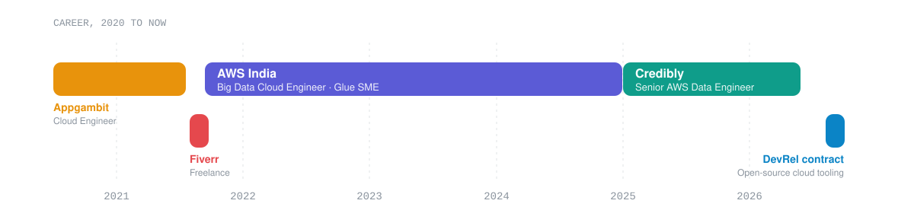

I spent three years on the AWS India Big Data team as an AWS Glue Subject-Matter Expert, built Credibly's first production data lake as its only engineer, and run developer communities in Surat on the side. **Available for full-time, part-time or contract work** in DevRel, solutions architecture and data engineering. Remote from Surat, happy to travel.

 

- Sending fixes to open-source data tools, most recently **Tower** and **LakeSail Sail**
- Organising the next **AWS User Group Surat** and **Cloud Native Surat** meetups

 

| Project | Contribution | When |
| :--- | :--- | :--- |
| [tower/tower-cli](https://github.com/tower/tower-cli) | [#381](https://github.com/tower/tower-cli/pull/381) Fix for qualified table name namespaces | Nov 2026 |
| [lakehq/sail](https://github.com/lakehq/sail) | [#2977](https://github.com/lakehq/sail/pull/2977) Fix for AWS Glue views | Nov 2026 |
| [galaxy-io/filament](https://github.com/galaxy-io/filament) | Issues [#611](https://github.com/galaxy-io/filament/issues/611), [#612](https://github.com/galaxy-io/filament/issues/612), [#613](https://github.com/galaxy-io/filament/issues/613) from a hands-on Filament vs AWS DMS test. #611 was fixed in #615. | Oct 2026 |
| [datazip-inc/olake](https://github.com/datazip-inc/olake) | [#1338](https://github.com/datazip-inc/olake/pull/1338) | Oct 2026 |
| [near-realtime-business-metrics](https://github.com/nirmalpatel008/near-realtime-business-metrics) | My own repo: a DMS CDC pipeline with KPI queries, a dashboard and Glue Data Catalog integration. The reference implementation behind my Summit 2026 talk. | 2026 |

 

- Wrote hands-on tutorials, including multi-cloud GCP and AWS deployment walkthroughs
- Found a version-pin regression through A/B testing (10 vs 225 rows returned) and fixed the sample stack
- Got two PRs merged into the core repo and docs site

- Designed and delivered the company's **first production data lake on AWS** as the only engineer
- Introduced **change data capture** as a new platform capability, making DynamoDB data queryable for the analytics team for the first time
- Migrated **14 DMS replication tasks** across four source databases into a hardened production account, consolidating nine endpoints to six, with KMS, Secrets Manager and cross-account VPC peering
- Found an overlap between two CDC tasks that was quietly duplicating **137 tables** and fixed it with **122 exclude rules**
- Defined the whole production account in **CloudFormation across 8+ stacks**, with no console changes
- Wrote the DMS Serverless vs Aurora Zero-ETL evaluation that became my **AWS Summit 2026** talk

- Accredited as an **AWS Glue Subject-Matter Expert**, the deepest specialist designation for the service in the Big Data support org
- Three years debugging Glue and Spark workloads, VPC networking and Lake Formation permissions, often on live calls with customers' engineers
- Built an internal **MWAA plugin packager** in Python that became the standard ramp-up path for private MWAA environments
- Received the **Rising Star** award

- Serverless SaaS products on AWS with Node.js and the Serverless Framework
- CI/CD on CodePipeline, CodeBuild and CodeDeploy

 

**2026**

- **CloudSpark Challenge, RNGPIT** · Nov 2026. Hands-on AWS session for computer engineering students, online.
- **AWS Community Day Surat 2026** · Oct 2026. Opened Surat's first AWS Community Day as an organiser. [Event site](https://acd26.awsugsurat.com/) · [Recap](https://lnkd.in/p/d5BSdkVc)
- **Cloud security on AWS, SVNIT Surat** · Oct 2026. Session for students at Sardar Vallabhbhai National Institute of Technology.
- **AWS hands-on workshop, Auro University** · Sep 2026.
- **Cloud Native Surat kickoff** · Sep 2026. Infrastructure with SQL. [Event](https://ocgroups.dev/cncf/group/ce7dvxw/event/jwxkd82)
- **AWS Cloud Club launch, SCET** · Aug 2026. [Post](https://lnkd.in/p/dQrwAk9V)
- **AWS Cloud Club launch, RNGPIT** · Jul 2026. [Post](https://lnkd.in/p/dZZnyiqC)
- **AWS Summit Bengaluru 2026** · Apr 2026. Building near real-time data pipelines with AWS DMS: Aurora to Aurora, full load plus CDC. [Video](https://youtu.be/YDKte_7OkqE) · [Article](https://builder.aws.com/content/3D1dYOYynMHfhqiIRoEYV89LgSH/building-near-real-time-data-pipelines-with-aws-dms-full-load-cdc)
- **AWS Cloud Club launch, PPSU** · Feb 2026. Cloud fundamentals and certification paths for 500+ students online. [Post](https://lnkd.in/p/dFTG6Hh3)
- **AWS re:Invent 2025 recap and Kiro workshop, AWS User Group Surat** · Jan 2026. [Event](https://www.meetup.com/surat-aws-user-group/events/312635613/)

**2025**

- **AWS Community Day Vadodara 2025** · Sep 2025. From data chaos to insights: Zero-ETL on AWS. 600+ attendees. [Video](https://youtu.be/lh3vMIL85T4)
- **AWS Community Day Ahmedabad 2025** · Jun 2025. Near real-time data pipelines. [Post](https://www.linkedin.com/posts/awsahmedabadcommunity_awscommunityday-nirmalchhodavadiya-dataengineer-activity-7342225773296037888-gVeH)
- **AWS Summit Bengaluru 2025** · May 2025. From meetup attendee to AWS engineer, Developer Lounge. [Post](https://www.linkedin.com/posts/nirmalpatel008_awssummit2025-awscommunity-lightningtalks-ugcPost-7329076164017238016-y-Is)
- **Listen to Expert, AWS Ahmedabad Community** · Feb 2025. Guest expert session. [Post](https://www.linkedin.com/posts/awsahmedabadcommunity_aws-awsusergroups-listentoexpert-activity-7303617911242330112-6uXo)

Full history on [nirmalchhodvadiya.in](https://nirmalchhodvadiya.in/#timeline).

 

I'm one of the organisers of **[AWS User Group Surat](https://www.meetup.com/surat-aws-user-group/)**. The group existed before I joined it. I first walked in as an attendee, before I had a job in cloud, and years later ended up helping run it alongside co-organisers and a volunteer crew who handle the venues, the registration desk and everything else that makes an event happen.

- 4,000+ members on Meetup and 2,000+ followers on LinkedIn
- Monthly meetups, averaging around 70 RSVPs
- **[AWS Community Day Surat 2026](https://acd26.awsugsurat.com/)**, Surat's first, with 500+ registrations. I'm listed in the core team as AWS UG Surat Lead.

Also co-organiser of **[Cloud Native Surat](https://ocgroups.dev/cncf/group/ce7dvxw)** (CNCF), **[Stripe Community Builder for Surat](https://www.stripecommunity.com/home/clubs/surat/overview)**, and AWS Community Builder in 2021 (Networking and Content Delivery).

 

Industry expert lectures for the MCA Cloud Computing course at R.N.G. Patel Institute of Technology, plus AWS sessions and workshops at SVNIT Surat, Auro University, PPSU, SCET and RNGPIT, including a two-day CloudGem hackathon. College workshops run through [CloudVidya](https://cloudvidya.in), which I started to bring hands-on AWS training to engineering colleges in South Gujarat.

 

- **[How do I troubleshoot the "Unable to execute HTTP request... connect timed out" error in AWS Glue?](https://repost.aws/knowledge-center/glue-connect-time-out-error)** AWS Knowledge Center, written while I was at AWS India.
- **[Building near real-time data pipelines with AWS DMS (full load + CDC)](https://builder.aws.com/content/3D1dYOYynMHfhqiIRoEYV89LgSH/building-near-real-time-data-pipelines-with-aws-dms-full-load-cdc)** AWS Builder Center, the written version of my Summit 2026 talk.
- **Tutorials on dev.to:** [Auditing three clouds without writing three scripts](https://dev.to/nirmalpatel008/auditing-three-clouds-without-writing-three-scripts-5fhc) · [Query before you mutate](https://dev.to/nirmalpatel008/query-before-you-mutate-how-agents-should-touch-your-infrastructure-1h25) · [Continuous cloud audit in CI/CD](https://dev.to/nirmalpatel008/add-continuous-cloud-audit-to-your-cicd-in-ten-minutes-4nk2) · [Declarative cloud stacks in SQL](https://dev.to/nirmalpatel008/declarative-cloud-stacks-in-sql-an-intro-to-stackql-deploy-41i) · [One manifest, two clouds](https://dev.to/nirmalpatel008/one-manifest-two-clouds-multi-cloud-infrastructure-with-stackql-deploy-358j)
- **[I Am a Cloud Builder](https://www.youtube.com/playlist?list=PLKb-zQGRRZsmdcvoNnVa59YXBEZHmsUlR)**, a BeSA video series I host with AWS Community Builders, Heroes and user group leaders about how they got into cloud.
- **[YouTube](https://www.youtube.com/@nirmalpatel008)**, talks, AWS data tutorials and live demos.

 

**Data and analytics** 
         

**Languages and data stores** 
       

**Platform** 
       

**DevRel** 
     

 

1. [AWS Certified Data Engineer – Associate (DEA-C01)](https://www.linkedin.com/posts/nirmalpatel008_aws-certified-data-engineer-associate-was-activity-7456623145626554368-KViM), May 2026
2. [AWS Glue Subject-Matter Expert](https://www.credly.com/badges/80f50295-a58e-4ff7-991e-c321e300dd54/public_url), Sep 2024
3. [AWS Certified Cloud Practitioner](https://www.credly.com/badges/ef4893d6-99f8-41cf-b0c4-421c6292950a/public_url), Jul 2021
4. [AWS Certified Solutions Architect – Associate](https://www.credly.com/badges/9fd8b856-a070-436a-ba1c-ba55ebf62682/public_url), Jul 2021 (expired)

B.E. Computer Engineering, R.N.G. Patel Institute of Technology, Bardoli, 2016 to 2020, CGPA 8.66/10.

 

Full-time, part-time or contract, remote from Surat.

<b>Developer advocacy / DevRel</b>

 

I've run a user group, organised Surat's first AWS Community Day, spoken at two AWS Summits, hosted a video series and written for AWS. I've also shipped the production systems, so the demo holds up when someone asks a follow-up question. Best fit: data infrastructure, cloud platforms and developer tools.

<b>Solutions architecture, data and analytics</b>

 

Three years at AWS seeing customer architectures, most of them while broken, then a platform I owned end to end. I can scope a data platform, defend the tradeoffs in front of a customer, build the proof of concept and run the enablement session afterwards.

<b>Data engineering on AWS</b>

 

CDC with DMS, Glue and PySpark ETL, Iceberg and Athena on S3, all in infrastructure as code. Happy to join a team building or migrating a data platform.

 

Email is the fastest: [nmchhodvadiya008@gmail.com](mailto:nmchhodvadiya008@gmail.com)

If you're in or near Surat, come to a meetup and say hello.
